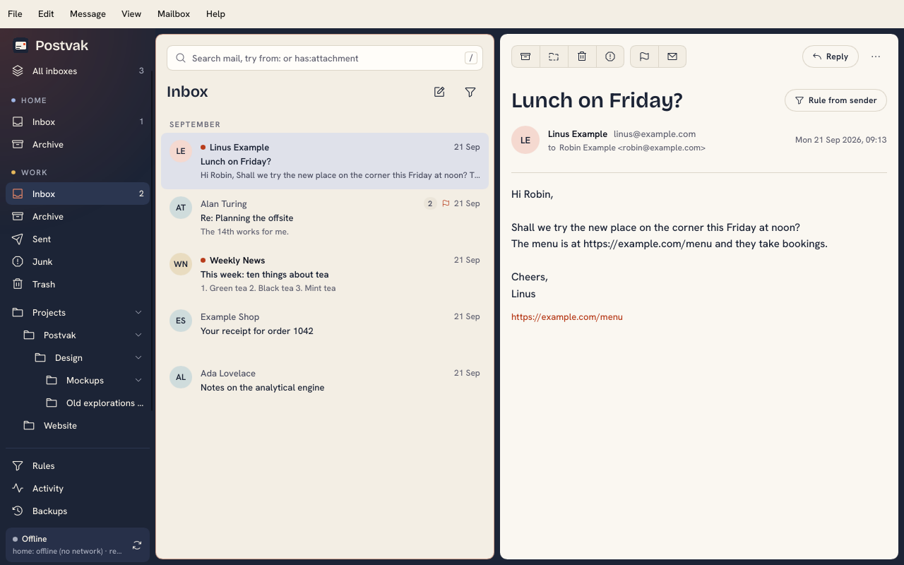
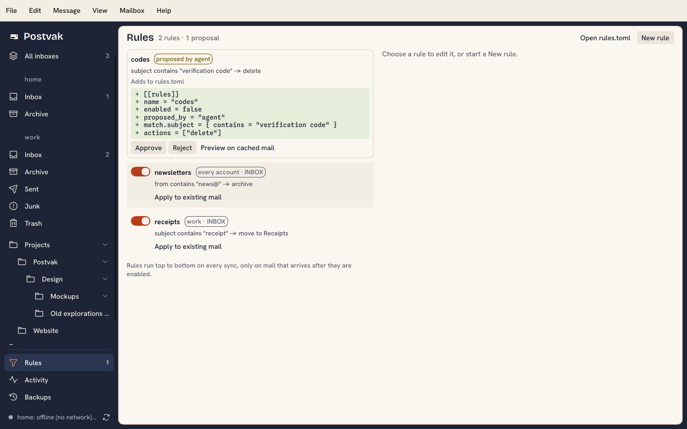
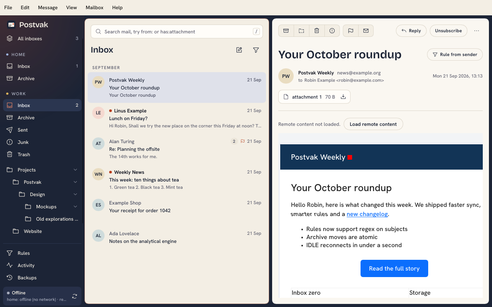
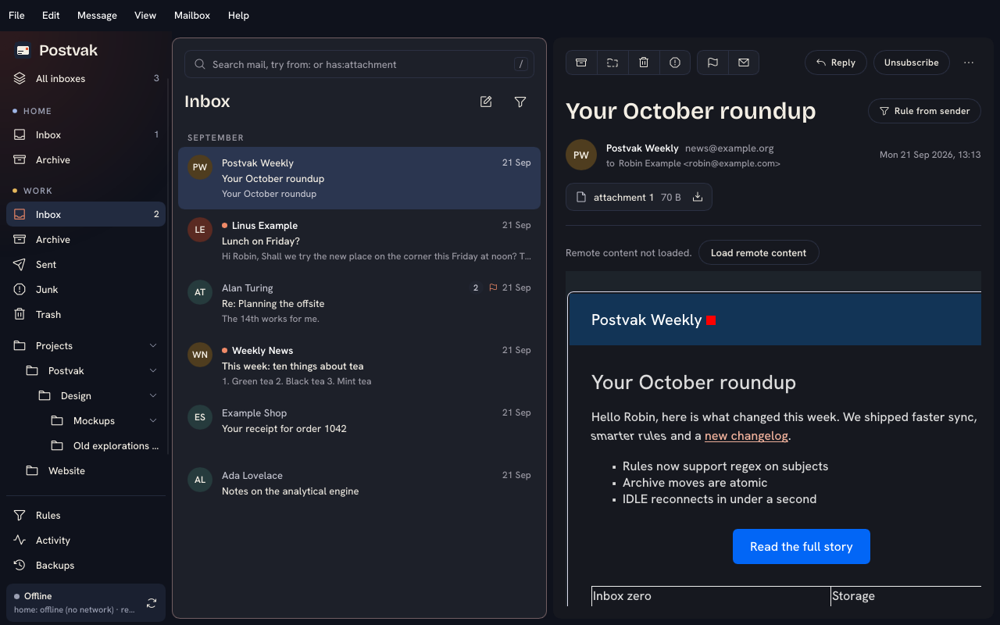

# Mail window



`postvak gui` opens a window with three columns: your accounts and folders, the threads in the chosen folder, and the selected message. Sync, rules and notifications run in the [daemon](daemon.md), which the window starts when none is running, so the window, the CLI and agents over MCP can all be open at once.

When the window cannot start, a small window says why and what to do, and the error also goes to stderr. With no account set up yet, that window holds the add-account form; saving it opens the mail window once the login passed, first saying so when no SMTP server was found. [Troubleshooting](#troubleshooting) covers a window that does not open at all. Closing the window does not stop sync. Where the desktop shows tray icons, Postvak puts one there with the unread count in its tooltip (in the macOS menu bar a plain glyph in the bar's own colour, without the name): closing the window then keeps Postvak running in the tray, and the tray's menu opens the window again, syncs, or quits. Without a tray, closing the window quits, also while a new message is open in a window of its own; what it holds is kept (see [Not losing what you wrote](#not-losing-what-you-wrote)). GNOME shows tray icons only with the AppIndicator extension (on Ubuntu it is on by default). While the window is open, Postvak's Dock icon on macOS, or its task bar or dock entry on Linux where the desktop supports it (Plasma, Ubuntu's dock, Dash to Dock), shows the unread count of all inboxes. Postvak opens one window: starting it again, from the dock, the launcher or `postvak gui`, brings back the window that is already open. A daemon the window started stops a minute after its last client goes; one you run with `postvak run` keeps going. If the daemon goes away while the window is open, the sync line says "background sync stopped — reconnecting" and the window tries again every five seconds.

The window remembers its size, its position (where the platform reports one; Wayland does not) and the width of its columns in `window.json`, next to `daemon.log` in the state directory. Delete the file to start from the defaults.

## Menu bar

The menu bar (in the window, or at the top of the screen on macOS) has the window's actions in one place: File (Save .eml, Save .eml as…, View source, Open at login, Preferences… with Ctrl+, (Cmd+, on macOS), Close window with Ctrl+W, Quit with Ctrl+Q; Cmd on macOS), Edit (Copy, Search), Message (Archive, Move…, Delete, Junk or not junk, Flag, Read or unread, Add to selection, Select all, Show original colours), View (Text or HTML, Theme, History, Keys), Mailbox (Add account…, Sync now, New folder…, Mark folder read) and Help (Postvak documentation, About Postvak). An item is greyed out when it would do nothing, as the reader's action buttons are. A dialog, such as About, Add account, Keys or a rule, fades in and dims the window behind it until it closes, at once; a click beside it closes it as Esc does, asking first when it holds unsaved changes. About Postvak shows the version, the licence and the Slint attribution. Add account… asks for the account's name, IMAP host, port, encryption (TLS or STARTTLS; typing port 143 picks STARTTLS, 993 TLS), username, password and address; the password goes to the OS keyring. It offers no unencrypted login; that is `tls = "none"` in `config.toml` (see [Accounts](accounts.md)), and an account logged in that way says "unencrypted" next to its name in the folder pane (shown for a lone account only then, or when its store fails to open) and on its sync line. Saving first has the daemon test the login, as `postvak account add` does; when it fails, nothing is saved and the form stays open with why, so you can fix a field and save again. Esc during the test closes the form and saves nothing. Once the login passed, the form finds the SMTP server: the one you gave under Outgoing server's Change (host, port and TLS or STARTTLS; an empty port means 465, or 587 with STARTTLS), checked by logging in, or else a guess (see [The SMTP server](sending.md#the-smtp-server)). A server you gave that fails its login refuses the save, with why. Then the account is saved, with the server found, joins the folder pane and its first sync starts, showing on its sync line; a toast says which server it sends through. When the guess found nothing, the account is still saved, and the form stays open to say sending is not set up, with a link to how to set one up; Done closes it. Saving a name that exists replaces that account.

File ▸ Open at login starts Postvak when you log in, out of the way: hidden in the tray, or minimized in the Dock on macOS, where clicking the Dock icon brings the window back. On a desktop without a tray, such as GNOME without the AppIndicator extension, the window opens instead, since a hidden one could not be reached. On macOS 13 and later Postvak.app adds itself to System Settings › General › Login Items, where you can also turn it off; if macOS asks you to allow it there, Postvak opens that page and says so. Older macOS, the Homebrew formula's `postvak`, a `postvak autostart on` run through the cask's `postvak` command and a `POSTVAK_HOME` of your own use a launch agent in `~/Library/LaunchAgents` instead, which turning it on from the app replaces. On Linux it is an entry in `~/.config/autostart`, which your desktop's startup settings also list (a compositor such as Hyprland or Sway does not read it by itself: Postvak then says which line to add to its startup instead, see [Install](install.md#hyprland-sway-and-other-compositors)); in the Flatpak, Postvak asks the desktop through its Background portal, which may ask you first. `postvak autostart on`, `off` and `status` do the same from a terminal. The window at login is apart from `postvak service install`, which keeps the daemon syncing without any window.

File ▸ Preferences… changes what `config.toml` holds, saving each change at once and keeping the file's comments. General has the theme, Open at login, Check for updates (`check_updates`), Show sender logos (`sender_images`) and HTML mail colours (`html_colours`). Accounts has, per account, Notifications (`notify`), Sync every (`sync_interval_secs`), Keep deleted mail for (`trash_retention_days`), Search message text (`index_bodies`), the aliases and the trusted authserv-ids. Sending has Undo send (`undo_secs`), a signature per address of every account, saved with its own Save button rather than per keystroke, and each account's SMTP server with Save guess and Guess again (see [Sending mail](sending.md)). The daemon restarts only the account you changed. An account's IMAP server and login are not changed here: add it again under the same name, or edit `config.toml`. Preferences is in the window only; from a terminal or an agent, edit `config.toml` (see [Accounts](accounts.md)). On macOS it sits in File rather than the Postvak menu, which Slint does not let an app add to.

Drag a message onto a folder of its account to move it there; drag a marked message to move every marked one. Right-click a message for read, flag, archive, move, delete, junk, View source, Save .eml and Save .eml as…; a folder for Open, Collapse or Expand, Mark all as read and Sync now, and Trash and Junk (or Spam) also for Empty Trash… or Empty Junk…, which asks first, then deletes everything in it (backed up, so Undo or Backups brings it back); a link in an HTML message to open or copy it. In the tray, Open Postvak, Sync now and Quit.

## Keys

| Key | Action |
|---|---|
| `j` / `k`, Down / Up | next or previous row; in the folder pane, next or previous folder |
| Right / Left | expand or collapse a thread |
| `x` | add the row to the selection, or take it out |
| Ctrl+A (Cmd+A on macOS) | in the list, add every row to the selection; in the message, select its text |
| `e` | archive |
| `#`, Delete (Backspace on macOS) | delete: move to Trash; from Trash, or with no Trash folder, delete for good after saving an `.eml` backup |
| `!` | junk: tag `$Junk`, which trains the server's spam filter, and move to the Junk folder; in the Junk folder, not junk: tag `$NotJunk` and move to INBOX |
| `m` | move: type to filter the folders, Enter |
| `u` | mark read or unread |
| `s` | flag or unflag |
| `v` | show HTML mail as text, or as HTML again |
| `z`, Ctrl+Z (Cmd+Z on macOS) | undo the last action taken in this window that is not undone yet, see [Undo](#undo) |
| `/` | search this account, or every account from All inboxes (see [Search](search.md)); while the background index is incomplete, Enter asks the server too, whose hits join the list as they arrive. When few messages match as typed, close matches follow under their own heading: a word within one typo of what you typed (two for a long word), taken from the mail itself |
| `r` / Shift+R / `l` / `f` | reply, reply all, reply to list, forward, see [Writing mail](#writing-mail) |
| Ctrl+N (Cmd+N on macOS) | new message, in a window of its own |
| Ctrl+Enter (Cmd+Enter on macOS) | in the message being written, send it |
| Esc | close a popup, leave search, clear the selection; in the message being written, close it, asking first when you changed it |
| Tab | next pane: folders, list, body |
| Ctrl+R (Cmd+R on macOS) | sync every account now |
| `?` | show these keys |

The letter keys and Right / Left act on the list and the open message; with the folder pane focused, only `j` / `k`, Down / Up, Tab, Esc, `/`, `?`, Ctrl+R and the menu shortcuts work. Ctrl+C (Cmd+C) copies text selected in an HTML message.

Each attachment of the open message shows with its name and size and a save button, which saves it to your Downloads folder, or to your home folder when there is none; right-click it for Save as…, which opens your desktop's save dialog in that folder with the attachment's name filled in. The file goes where you choose; the dialog asks before replacing one. On Linux the dialog is your desktop's own, through its file chooser portal, so it also works in the Flatpak, which can then write where you chose and nowhere else; on macOS it is the system save panel.

With the mouse, Shift-click selects every row from the current one to the one you click, and Ctrl-click (Cmd-click on macOS) adds a row to the selection or takes it out; the first one also selects the current row.

Actions apply to the selection when there is one, else to the current row; on a thread row they apply to the whole thread in that folder. A message you open, with the keys or a click, is marked read after its text has been on screen for a second; the one a folder opens on stays unread.

In All inboxes each action goes to the message's own account. `m` offers the folders of that account; marked messages from more than one account cannot be moved together.

### Undo

After an action, a toast at the foot of the list says what it did, such as "Archived 1 message", with **Undo** and its key `z`. It goes after 8 seconds, or when the next action replaces it; it stays while the pointer is on it. `z` and Ctrl+Z (Cmd+Z on macOS) undo the newest action of this window that is not undone yet, also after its toast went, one action further back each time. An action on a selection across accounts is undone as one. Undo moves the mail back to the folder it came from, sets read, flagged and tags back, and restores deleted mail from its `.eml` backup, as a new message without its flags and with today's arrival date. A message that changed since, such as one moved again or deleted on the server, is left alone, and the toast says how many were. Undoing an undo is not offered; take the action again instead. The Activity view's **Undo** does the same for the action of the chosen row, a rule's included.

## Folders

With two or more accounts, **All inboxes** at the top of the folder pane lists the INBOX of every account in one list, newest first; its count is the unread mail in all of them.

Each account lists its INBOX and special folders (Archive, Drafts, Sent, Junk, Trash) first, then your own folders as a tree that follows the server's hierarchy. Each level steps in a little, up to three; deeper folders line up with the third level, are cut off with "…" when long, and show their whole path on hover. Click the chevron on the right of a parent to fold or unfold its branch; folding lasts until you close the window. A parent the server does not list as a folder is shown but cannot be opened. The folders scroll, while Rules, Activity and Backups stay at the bottom of the pane.

### Managing folders

Right-click a folder, or the account's name for a top-level one (Mailbox ▸ New folder… with a single account, whose name the pane leaves out), for **New folder…**, **Rename…** and **Delete…**. `postvak folder create`, `rename` and `delete` do the same. A new folder is subscribed, so other mail apps show it too.

- **New folder** on a folder makes a subfolder of it; on the account's name it makes a top-level folder, which on servers that keep every folder under INBOX goes under INBOX.

- **Rename** changes the folder and the folders under it. Rules that name it follow. A rule for every account is split into one copy per account, named `<name> (<account>)`, so only the account's own copy follows the rename.
- **Delete** of an empty folder just removes it. A folder holding mail says how many messages it holds and asks whether to move them to Trash or delete them permanently; moving them to Trash is offered only when the account has a Trash folder. A permanent delete saves each message as an `.eml` backup first; Backups, or `postvak trash restore`, brings one back and creates the folder again if it is gone.
- INBOX and the special folders (Archive, Drafts, Sent, Junk, Trash, and the server's own such as Gmail's All Mail and Starred) cannot be renamed or deleted, and a folder with one under it cannot be renamed. Nor can a folder be renamed into one of its own subfolders.
- A folder with subfolders cannot be deleted; delete or move the subfolders first.

## Message actions and search

The top of the reading pane has buttons for Archive, Move, Delete and Junk in one group, and Flag and Read or unread in another; the first group shows their names when the pane is wide enough, and hovering one shows its key. They act on the selection or the current row, like the keys. On the right, **Reply** (`r`) answers the sender (the address in Reply-To when the message has one) in the reading pane, and the **⋯** button beside it holds **Reply all** (`Shift+R`), **Reply to list** (`l`, for mail from a list that takes posts), **Forward** (`f`) and the rest of what can be done with the open message, below. See [Writing mail](#writing-mail).

A message a rule acted on shows a strip under its sender saying what the rule did and when, such as "Moved to Travel by rule travel at 07:02"; your own actions show none. **Edit rule** opens that rule, **Move back** returns the message to the folder the rule took it from while that folder exists, and **Why?** lists each of the rule's conditions and whether the message meets it, checked against the rule as it reads now. When several rules acted on the message, **and N more** lists every action. A rule since removed from `rules.toml` is marked "(removed)". Mail a rule moved to Junk or Trash shows no strip there yet: the log does not tie those moves to the copy that arrived. In the Archive folder the archive button moves mail back to INBOX, and in the Junk folder the junk button reports it as not junk. With two or more messages selected, the reading pane lists them under "3 messages selected" instead of showing one, and the same buttons, now with their names, act on all of them; **Clear selection** (or Esc) empties it. The search field at the top of the message list starts a search, like `/`.

## Writing mail

**Reply** (`r`), **Reply all** (Shift+R), **Reply to list** (`l`) and **Forward** (`f`) open the message you write at the top of the reading pane, with the original shown below it as the reader shows it; drag the line between them to give either more room, and the window remembers it. The original is not edited: the quote goes in below your text when the message is sent, as `postvak send` puts it. While the original downloads, the message says "Loading the message…" and Send and the fields wait; they wait while it is being sent too. A new message (Ctrl+N, Cmd+N on macOS, the pencil button above the list, or File ▸ New message) opens in a window of its own, on the account of the folder in view, titled with its subject once it has one; you can have several open. A `mailto:` link in a message opens a new message too, with the address, subject and text the link names, rather than another mail app.

From lists the account's address and its aliases (a new message lists every account's); type a full address for an alias with a `*`. **Cc Bcc** shows those fields, which show by themselves when they hold an address. As you type an address, the people you wrote to (in every account's Sent folder) are offered first, then the senders of your mail, newest first; Up and Down choose, Enter or Tab takes one, Esc closes the list. Each address is checked as you leave its field, and a bad one is marked there.

**Attach…** opens your desktop's file dialog (on Linux through its file chooser portal, so it also works in the Flatpak; the open panel on macOS), where you can pick several files. Dropping a file on the message does not work yet: attach it with the button. Each file shows with its name, size and a button to remove it, and the line beside them adds up what is attached against the largest message the account's server takes (as its last connection said, else 25 MB), saying so at once when it is too much. A forward lists the original's attachments the same way, each one kept until you remove it; **Send as attachment** sends the original whole instead.

**Send** (Ctrl+Enter, Cmd+Enter on macOS) checks the message first: a missing recipient, a bad address or From, or too much attached shows on its field, and nothing is sent; so does an attached file that can no longer be read, said at the top of the message. Then the message closes and goes to the daemon's outbox, as `postvak send` does, and waits there for the undo delay (`[sending] undo_secs`, see [Sending mail](sending.md#the-outbox-and-the-undo-delay)). The toast says "Sending to Ann in 10 s" and counts down; its **Undo**, or `z`, takes the message back, says "Not sent", and opens it again as it was: a reply or forward over its original, or as a new message that still answers it when the original is gone. Once it is on its way the toast says "Already on its way". With no undo delay the toast says "Sent". Closing the window does not stop a message that waits; the daemon sends it.

While a reply or forward waits, a small clock shows beside the subject of the original's own row, and the original gets its answered or forwarded flag once the message went. In a collapsed thread whose newest message is another, the clock shows once you expand it.

The status line says "Sending 1 message" while the outbox holds mail, and "Not sent" with how many failed when one could not go. Click it for the outbox: what waits and what failed in every account, with when each goes or why it failed, and **Retry** for one that failed for good. `postvak outbox` shows the same list.

**Close** (or Esc) closes a message you did not change at once. **Discard**, closing a changed one, and anything that takes the reading pane from your reply (another message, another folder, a search, moving the original away, another reply) ask "Discard this message?" first; Discard on a saved draft asks "Delete this draft?" instead (see Save draft below).

**Save draft** (Ctrl+S, Cmd+S on macOS) saves the message as a draft in the account's Drafts folder on the server (the folder the server marks as Drafts, else one named Drafts), so other clients see it too. The toast says "Draft saved"; saving again replaces the earlier copy. An account without a Drafts folder says "This account has no Drafts folder". Closing a changed message, or anything that takes the reading pane from it, asks to **Save draft**, **Discard** or **Cancel**. Discard there drops what you changed since the last save and keeps a draft you saved before. The **Discard** button on a message that has a saved draft asks "Delete this draft?" and deletes it; **Close** leaves it. On a server without UIDPLUS, a draft copy can stay in Drafts when another client left deleted mail there.

**Edit draft** in the reader (only in Drafts), or Enter on a draft's row, opens the draft in the composer: a reply or forward over the message it answers, new mail in a window. A draft from another client opens with its whole text, quote included, and its attachments; it shows over the message it answers when that is stored, and is sent as written. A draft that had only HTML opens as text, with a note. A draft without a Message-ID says that saving or sending it leaves the old copy in Drafts. A draft you send leaves Drafts once its message has gone; Undo, or a failure, leaves it there.

In the outbox, a message that failed has **Edit**: it saves the message as a draft and opens it. If the message cannot be taken out of the outbox, the draft copy is removed again and the row says why, so a message is always in exactly one place.

### Not losing what you wrote

Every five seconds, each message you changed is kept in a file of its own in the `compose` folder of the state directory, next to `daemon.log`, until it is sent or discarded. Quitting Postvak, from the menu, the tray or by closing the window without a tray, asks nothing and keeps them the same way. When the window crashed or quit with messages open, the next start opens them again with the line "Restored after Postvak closed": a reply or forward in the reading pane over its original, a new message in its own window. A reply whose original is gone from the folder, say because a rule moved it, opens as a new message that still answers it. One that was being sent as Postvak closed says "This may have gone before Postvak closed: check the outbox or Sent", and its first Send asks "Send it again?" before sending it. When more replies or forwards were left than the reading pane holds, the status line says how many more are kept for a later start. A reply whose original goes while you write it, and so cannot be quoted at Send, moves to a window of its own as a new message that still answers it, saying so; Send sends it from there. Hiding the window to the tray keeps the messages open as they are.

## Message list

Each row starts with the sender's initials on a colour picked from their address, or their logo with `[ui] sender_images = true`, as in the reader, then three lines. The first has a dot when the message is unread, the sender (the recipient in Sent and Drafts), a pill with the number of messages in a thread, a flag (or a check when marked) and the date. The second is the subject, and the third the start of the message's text, muted, with a paperclip when it has an attachment. Unread senders and subjects are darker and bolder. In All inboxes the account name comes before the sender, and in search results the folder before the subject, as "[Archive] …"; a search hit that matched in its body shows the text around the match in place of the subject. Dates read "09:30" today, "Sun 18:00" within the past week, "3 Sep" earlier this year and "10 Dec 2025" before that. A long sender, subject or text is cut off with "…".

Headings group the rows by date: Today, Yesterday, This week, then each month, with its year once it is not this year's. Search results have no date headings; close matches follow under their own.

While rule proposals wait for your approval, a card above an inbox's messages (and All inboxes') says so: with one, who proposed it, what it does and how many messages it would affect; with more, how many wait. **Review** opens Rules. It stays until the proposals are approved or rejected.

The funnel button beside the list's title shows All, Unread, Flagged or Attachments: a thread stays when one of its messages fits. Any choice but All shows as a chip beside the title, which clears it, and as a dot on the funnel. Attachments is a guess from the headers (mail sent as `multipart/mixed`), the same guess Thunderbird makes. The choice holds as you change folders; search results ignore it. On the CLI and over MCP, `list` takes `--unread`, `--flagged` and `--attachments`.

## Sync status

The foot of the folder pane has one line about sync: a failure when there is one (a login the server rejected also counts, with when it retries, as Postvak tries it only hourly; the sync button beside it tries it at once), else an account that is offline and when it retries, else one that is syncing (which folder, how many headers or bodies of how many, with a thin bar under the line that fills as they come in), else that the first account is up to date, with how far its search index is while it builds. An account whose server lacks `UIDPLUS` has `server lacks UIDPLUS` at the end of its line (see [Other mail clients](daemon.md#other-mail-clients)). Hover it for every account's line, click it for the last 50 lines. The button beside it syncs every account now (Ctrl+R, Cmd+R on macOS). View ▸ Theme picks the System, Light or Dark theme and saves it as `[ui] theme` in `config.toml`. Both themes put the panes in an ink-blue frame: warm paper in light mode, near-black in dark mode. When the desktop asks for less motion, the window's fades are instant and a syncing account's dot stops pulsing: Reduce motion in macOS's Accessibility settings (read again each time the window gains focus), Animations off in GNOME, Animation speed at Instant in Plasma, or `reduced-motion` from another desktop's Settings portal. A Linux desktop without that portal keeps the motion. Under the line, a link appears when a newer release is out; it opens that release's notes on GitHub. Postvak does not update itself, and the daily check runs only with `[ui] check_updates = true` in `config.toml` (see [Accounts](accounts.md#appearance)).

## Rules, Activity and Backups



These three views sit at the bottom of the folder pane.

**Rules** lists proposals first, each as a card with who proposed it, what it does in one line, the TOML it adds to `rules.toml` and a dry run on the mail already downloaded: how many messages it would act on, the newest three of them, and that nothing is changed until you approve. The dry run is counted as soon as the proposal arrives and again after each sync, without changing anything. **Approve rule** turns it on, **Reject** removes it, and **Edit before approving** opens it in the rule dialog; saving there keeps it a proposal for you to approve. A proposed change to a list shows the list's line before and after and, per rule that uses it, the messages it matches now and once approved; **Approve change** writes it into `rules.toml`. Then a table of every rule, one row each: its number in the order rules run, a switch, its name, the account and folder it watches (Watches), its conditions (When), its actions (Then, where a delete is marked and said to keep a backup), how many messages it acted on in the last 30 days with a bar to compare rules by, and when it last did ("no matches yet" for a rule that never has). A rule that fired long ago but shows 0 may have stopped matching your mail. Your own actions and Apply to existing mail are not counted. Click a column heading to sort by it, and again to reverse; # puts the rules back in the order they run. While the table is in that order, drag a rule onto another to change when it runs: a line shows whether it lands above or below that rule, and `rules.toml` is rewritten keeping your comments, the ones right above the rule moving with it. Type in Filter rules to show only the proposals and rules with every word you type in their name, who proposed them, account, folder, conditions or actions, ignoring case; each rule keeps its #, and leaving the view clears the filter. Click a rule, or New rule, to edit it in a dialog: its name, whether it is on, the account and folder it watches, its conditions and its actions. Test counts what it would do to the mail already downloaded, Save writes it to `rules.toml` keeping your comments and closes the dialog, and Remove rule takes it out after asking. Saving a change restarts the rule, so it acts only on mail that arrives after you save. A text or domain condition can be **in list** instead of a value: pick one of the [lists](rules.md#lists) in `rules.toml` of the right kind, text lists for from, to, cc, subject, body and a header, domain lists for from domain and to domain, and its values show under the row; change them in `rules.toml`. Conditions the form cannot edit (`any`, `none`, lists of values, a domain list mixed with domains) are shown as they are and kept on save. Closing the dialog, or opening another rule, while this one has unsaved changes asks to Save, Discard or Cancel. Apply to existing mail, in the dialog of a saved rule that is on, runs it once over the mail its accounts already hold, as `postvak rules apply-existing` does; when it would delete mail from the server for good, it first says how many messages per account and how long their `.eml` backups are kept, and runs only after Delete and apply; the sync line shows how many actions it took on how many messages. **Rule from sender** beside a message's subject in the reader starts a new rule for mail from its sender, watching that account and folder; it is not written to `rules.toml` until you add an action and save it. Open rules.toml opens the file in your text editor. Changes to `rules.toml`, from the window or from your editor, take effect within about two seconds for new mail. **Activity** is the log of what rules and your actions did; choose a row and **Undo** puts back the whole action it is part of (see [Undo](#undo)), as `postvak undo` does. **Backups** lists the `.eml` backups of mail deleted for good (deleted from Trash, from an account without a Trash folder, or by a rule), with Restore, and Purge, which removes the backups older than each account's retention period as `postvak trash purge` does and says how many in the sync line. Click a column heading in Activity or Backups to sort by it. Mail moved to the server's Trash folder is in that folder in the tree.

The daemon applies changes to `config.toml` by itself. An account added from the window joins it at once; other changes show when you reopen the window, and the window says so.

## HTML mail



Mail with an HTML part shows as its sender laid it out; `v` switches that message to its text and back. An HTML part with no markup in it but line breaks (`<br>`), plain text sent as HTML, shows as text, line breaks kept and entities such as `&amp;` decoded. Images sent inside the message show. Images and stylesheets from the web are not loaded until you ask: when a message wants some, the line "Remote content not loaded." has a **Load remote content** button, which downloads it for that message. When the account trusts its provider's `Authentication-Results` (`trusted_authserv_ids`, see [Accounts](accounts.md)) and the provider vouches for the sender, loading also remembers the sender's domain, such as `example.org` for mail from `news.example.org`: later mail from that domain that the provider vouches for loads its remote content without asking, under the line "Remote content loads for example.org.", whose **Stop loading** button forgets the domain. Mail that only claims to be from that domain still asks. Loading tells the sender's servers your IP address and that you opened the message, so leave it off for mail you don't trust. Each download is capped at 16 MB and 15 seconds, and a message loads at most 200 of them. What Postvak downloaded stays in memory, never on disk, for an hour or until it quits (64 MB in all), so opening the message again, or other mail with the same images, does not ask the sender's servers again. Postvak never loads content from your own machine or local network, also not through a web address that leads there. No scripts run, forms do nothing and SVG images do not show. A page wider than 5,000 points or nested too deep shows as text. Hover over a link to see where it goes; in HTML and in text, only `http`, `https` and `mailto` links open: the first two in your browser, a `mailto` link as a new message. The app comes to the front: on Linux Postvak asks the desktop for the activation token that allows it, which Plasma and X11 honour; GNOME's Wayland session wants a token tied to the click itself, which Postvak's toolkit cannot ask for yet, so there the app may only say it is ready. In the Flatpak, links go through the desktop's OpenURI portal with that token; files Postvak opens, such as `rules.toml`, go through the sandbox's `xdg-open`, which drops it, so their app may open behind the window.

In the light theme the page is white. In the dark theme Postvak first asks the mail for its own dark design, as a browser in dark mode would, and shows mail that has one, or whose page is dark already, as its sender wrote it; only text outside the sender's own backgrounds, which would sit on the dark window, still changes where it would not read. A dark header above a light article does not make a page dark. Other mail is adapted: light backgrounds turn dark but keep their colour (a pale blue box becomes a dark blue one), and text or a link changes only where it would no longer read against what is behind it. Images, and whatever sits on a background picture that shows and spans at least half its box's width, keep their colours, and so do borders; a background picture that is not shown (remote content not loaded) leaves its box to be adapted like any other, and text beside a small background icon is adapted against what is behind it. The message itself is never changed: saving it or viewing its source gives what the sender sent. **Original colours** in the reader's ⋯ menu and Message ▸ Show original colours show the open message on a white page in its sender's colours, until you open another; `html_colours = "original"` under `[ui]` in `config.toml` does that for all mail (see [Accounts](accounts.md#appearance)).



HTML over 2 MB, or a page too tall or too broken to lay out, shows as text with a note saying why.

## Reader

The subject heads the message, then the sender's initials on a colour picked from their address, their name and address, the recipients and the date. With `[ui] sender_images = true`, mail that a trusted server found passing DMARC shows the logo its sender's domain publishes in place of the initials (see [Accounts](accounts.md#appearance)). When the account trusts its provider's `Authentication-Results` (`trusted_authserv_ids`, see [Accounts](accounts.md)) and the provider vouches that the mail comes from the domain in its From address, a green seal follows the address; hover over it to see which server checked and which domain. The seal says the mail really comes from that domain, not that the domain is the one you expect: `paypal-secure.com` can earn it as well as `paypal.com`, so read the address beside it. When that server found instead that DMARC failed for the From domain, an amber warning seal follows the address: the mail says it comes from that domain but the domain's own policy does not back it up. It may be forged; mail a mailing list passed on without rewriting the From address fails the same way. Without a trusted authserv-id no mail gets either seal.

**Save .eml**, in the reader's ⋯ menu, writes the message exactly as the server sent it to your Downloads folder (or your home folder when there is none), named after its subject; when that name is taken it saves beside it as "… (2).eml" and never replaces a file. File ▸ Save .eml as… and the message's right-click menu pick the place in the save dialog instead. The line under the attachments says where it went. Until the message is downloaded it and View source are greyed out. The reader shows "Loading…" meanwhile, or, while the account is offline, that the message loads when it reconnects. A message larger than 256 KB shows its text, its HTML and the images inside it as soon as those have arrived, and lists its attachments with their sizes; their save buttons stay greyed out until the rest of the message has downloaded. Above 5 MB the rest stays on the server: Save downloads just that attachment, and Save .eml or View source downloads the whole message first.

**View source**, also in the ⋯ menu, opens the message as plain text in a window, with control characters left out; Copy puts that text on the clipboard. Esc or moving to another message closes it.

Mail from a mailing list that says how to leave it (a `List-Unsubscribe` header) has an **Unsubscribe** button beside Reply. When the sender supports one-click unsubscribe (RFC 8058), Postvak sends that request itself, only to a public web host, and the line under the attachments says whether the sender accepted it. Once it did, a **Delete message** button beside that line moves the message to Trash; it takes only this message, not the rest of its thread. Otherwise it opens the sender's unsubscribe page in your browser, or a new message to their unsubscribe address. Either way the sender learns that your address reads its mail.

Mail with an HTML part has **Show as text** there, or **Show as HTML** while it shows as text, which does the same as `v`. View source always shows the whole message, whichever is active.

## Troubleshooting

The window draws with OpenGL. Where OpenGL cannot start (a virtual machine, a remote desktop, some Flatpak sandboxes, a broken or missing driver), Postvak starts again with Slint's software renderer, which needs no graphics driver and is slower on large windows. If no window opens even then, the error goes to stderr and to `daemon.log` in the state directory.

To use the software renderer from the start, for a bug report or a driver you know is broken, set Slint's own variable:

```sh
SLINT_BACKEND=winit-software postvak gui
```

**Safe mode** draws with the software renderer and ignores `window.json`, opening the window at its default size. `postvak gui --safe-mode` asks for it. Postvak also enters it by itself when the last two starts in a row died before the window showed; it counts them in `gui-starting`, next to `window.json`, which it removes as soon as the window shows. The window saves its layout as usual when it closes in safe mode, which replaces a `window.json` that kept it from opening.
